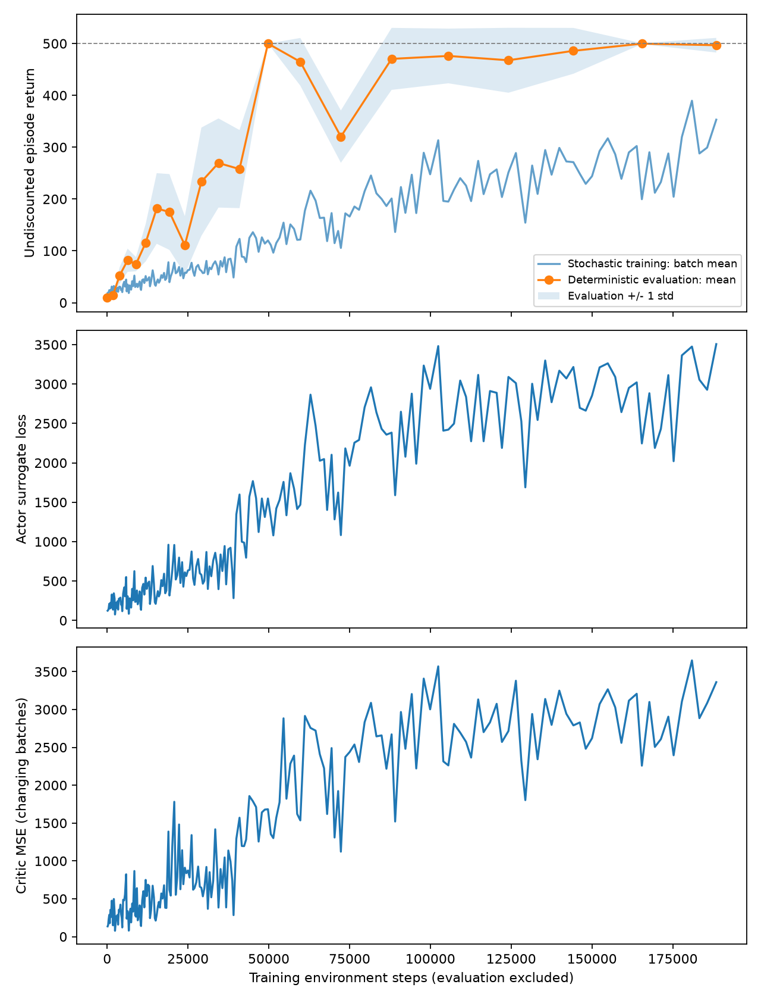

# REINFORCE + 学习到的 Monte Carlo baseline

## 2026-10-13：首次 200 次更新

[运行目录](20261013_201222_173552/)记录了 seed=0 的 200 次更新，共 188,461 个训练环境步。最佳模型在第 120 次更新、49,750 步时保存。

| 模型 | 固定评估种子 10000–10019 | 重新加载后，新种子 20000–20019 |
|---|---|---|
| best.pt | 500.0 ± 0.0 | 475.6 ± 41.7 |
| last.pt | 496.8 ± 14.2 | 467.2 ± 54.8 |

数值为确定性策略 20 局回报的均值 ± 标准差。重新加载的结果保存在 `reload_evaluation.json`。两个网络、两个优化器的状态均成功恢复；最优模型并不保证在新种子上仍满分。



此前无 baseline 的 seed=0 运行首次观测到满分在 50,565 步；本次为 49,750 步。这两个单次结果不足以证明 baseline 提高样本效率。critic 初始化还改变了后续动作采样的随机数序列，尚未进行严格控制的多 seed 比较。

## 运行与保存

此阶段保留完整 episode、外层折扣和按 episode 平均的 actor loss；尚未加入 bootstrap 或 GAE。每轮采集 8 局，先更新 actor 一次，再更新 critic 一次。

```powershell
.\.venv\Scripts\python.exe .\phase1_ppo\actor_critic.py --updates 200
```

每次运行在本目录创建独立时间戳子目录，包含配置、源码快照、每轮 CSV、训练曲线与汇总。`metrics.csv` 的 `loss` 是 actor loss，`critic_loss` 是当批回报标签的 MSE；不同批次标签发生变化，MSE 不要求单调下降。

`best.pt` 和 `last.pt` 均包含：

- `policy_state_dict`：actor 参数。
- `value_state_dict`：critic 参数。
- `optimizer_state_dict`：actor 优化器状态（保留与 REINFORCE 的兼容字段名）。
- `critic_optimizer_state_dict`：critic 优化器状态。
- 更新次数、环境步数、配置、最近一次评估的次数及结果。

最高确定性评估均值对应的模型保存为 `best.pt`，同分保留较早模型；`last.pt` 每轮覆盖。权重只存本地，不上传 GitHub。可以加载评估，尚未提供环境及 RNG 的精确断点续训。

```powershell
.\.venv\Scripts\python.exe .\phase1_ppo\evaluate.py "experiments/phase1_baseline/时间戳/best.pt" --episodes 20 --seed-start 20000
```

加 `--render` 可观看。比较原始 REINFORCE 时，应按训练环境步数对齐；单次训练 seed 的曲线不能证明 baseline 一定更好或方差更低。
