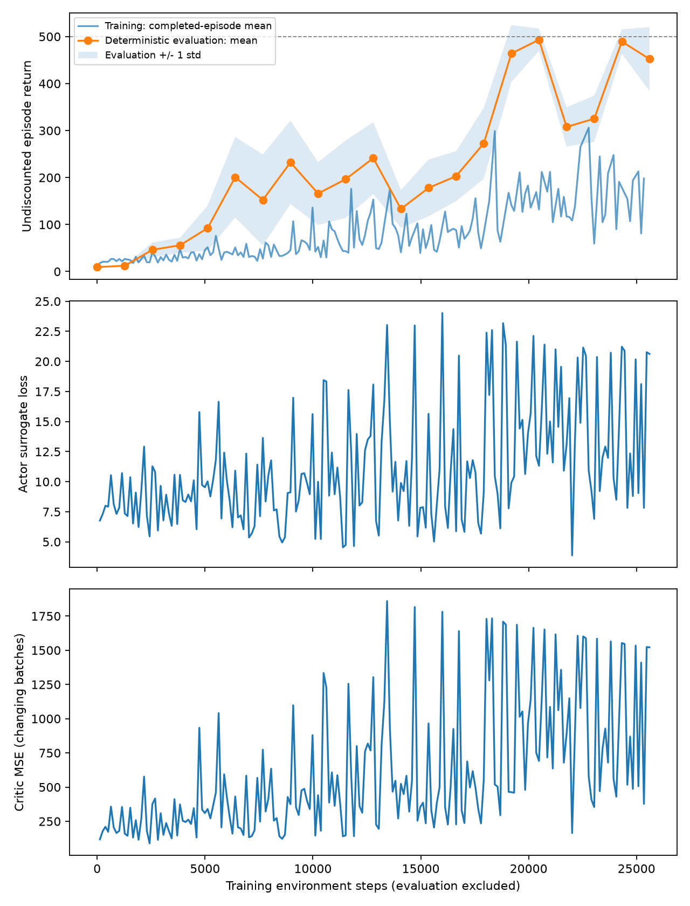

# 固定 rollout 的 n-step actor-critic

## 首次训练结果：2026-10-13

[运行目录](20261013_210840_045182/)包含 seed=0 的 200 次更新（25,600 个环境步）。最佳模型为第 160 次更新、20,480 步的 checkpoint，原评估均值 493.25；最终模型原评估为 452.4 ± 68.0。

重新加载 actor、critic 和两个优化器状态成功。使用新种子 20000–20019 做 20 局确定性评估：最佳模型 **482.3 ± 36.6**，最终模型 **411.0 ± 82.3**。结果保存在 `reload_evaluation.json`，说明后续更新仍有回落，尚不能宣称稳定收敛。



检查脚本覆盖了终止/截断/双标记优先级、尾部 bootstrap、状态连续性、标签冻结、样本平均 loss 及两个网络更新的梯度隔离。

## 使用方法

`phase1_ppo/actor_critic.py` 现在每轮采集固定 128 步，再更新一次 actor 和一次 critic。未引入 GAE、PPO、多 epoch 或 advantage 归一化。

```powershell
.\.venv\Scripts\python.exe .\phase1_ppo\check_rollout.py
.\.venv\Scripts\python.exe .\phase1_ppo\actor_critic.py --updates 200 --rollout-steps 128
```

## 数据与更新顺序

1. 从上个 rollout 留下的状态继续交互；仅在 episode 终止或截断时 reset。
2. 在两个网络更新前，用 critic 计算当前状态和真正下一状态的价值。
3. 倒序生成回报标签：真正终止时尾部为零，外部时间截断和 rollout 尾部使用下一状态价值，episode 内部则接上下一步回报。
4. 固定 `returns` 和 `advantages = returns - old_values`。
5. actor 最小化 `-(log_probs * advantages).mean()`，不使用完整 episode 版本的外层 `gamma**t`。
6. critic 最小化预测价值与固定 `returns` 的 MSE。

这是均匀 rollout 样本平均的工程采样约定；没有声称与完整 episode 的折扣梯度估计完全等价。

## 日志和保存

`train_mean` 为本批次结束的完整 episode 的平均回报，回报累计跨越 rollout 边界；本批没有 episode 结束时留空，终端显示 `n/a`，不会把 128 步奖励和误记为整局回报。

每次运行单独保存配置、源码快照、CSV、曲线，以及包含两个网络和两个优化器状态的 `best.pt` / `last.pt`。权重只存本地。评估与回放仍使用 `phase1_ppo/evaluate.py`。新运行从头训练，不自动续训。

200 次更新只有 25,600 个训练环境步；与此前完整 episode 训练比较时，应按环境步数而非更新次数对齐。先前的 Monte Carlo baseline 代码保留在 `experiments/phase1_baseline/20261013_201222_173552/source/` 快照中。
