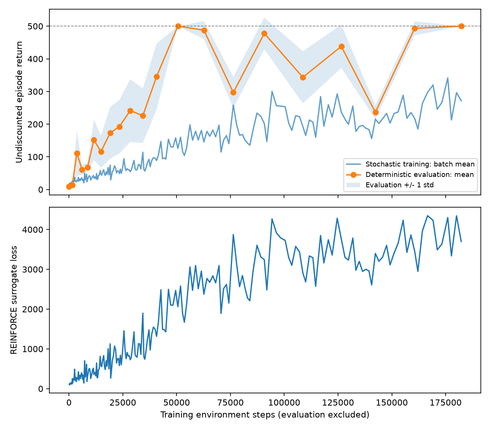

# REINFORCE 初次 200 次更新记录

来源：用户在 2026-10-13 提供的终端输出。本目录是历史日志归档，不是重新训练结果。

- 最终训练交互步数：182,228。
- 第 120 次更新（50,565 步）首次在可见日志中达到确定性评估 500.0 ± 0.0。
- 第 200 次更新最终确定性评估 500.0 ± 0.0；配置为固定 20 个评估种子。
- 中间评估存在明显回落，例如第 180 次更新为 236.4 ± 21.0。不能据此宣称稳定收敛或跨训练种子复现。
- 归档时的附件包含第 1–200 次更新和初始评估；CSV 保留日志中的四舍五入精度，初始评估标为 update=0。
- 原运行没有保存模型，进程退出后参数无法从日志恢复。本目录没有可加载的原次模型。
- 配置依据归档时检查的源码记录，未声称原运行保存过配置或代码版本。

`console.txt` 保留原始附件，`metrics.csv` 为解析数据，`summary.json` 记录来源、配置依据与限制。曲线阴影为每次评估的局间标准差，不是置信区间。
