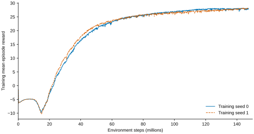

# G1：官方平地 PPO 基线结果

2026-10-19完成。固定镜像中的 `Isaac-Velocity-Flat-G1` / `G1_MINIMAL_CFG` / `newton_mjwarp`，训练seed=0、1均完成官方预算及独立评估。**站立、低/中速前进和左右转的定量门槛通过；启停的连续稳定停车门槛未通过。** 本轮训练与评估已经完成，不等于整个人形项目已完成。

## 训练与复现

每个seed使用4096环境 × 24步 × 1500轮 = 147,456,000环境步，单张RTX 6000 Ada，串行运行。官方奖励、PPO、网络、物理参数、噪声和随机化保持原样；覆盖训练seed及资产本地路径。两个实际保存的agent配置仅seed不同，环境配置仅seed和日志目录不同；源码快照一致。官方基线本身含质量、初始化、推扰等随机化，不能称为无DR。

|训练seed|结果目录|训练耗时|
|---|---|---:|
|0|[run_001](run_001/README.md)|1104.38秒|
|1|[run_002](run_002/README.md)|1072.90秒|

耗时为官方训练日志记录，未计入排队、首次镜像拉取及12个独立评估进程。两组各1500条loss均有限，actor/critic参数确实改变；最终模型为预先指定的 `model_1499.pt`，没有挑选最好checkpoint。

镜像、机器人资产及运行依赖见[环境记录](../phase3_g1_environment/run_001/README.md)。训练入口：[train_baseline.sh](../../phase3/training/train_baseline.sh)，评估入口：[evaluate_behaviors.py](../../phase3/evaluation/evaluate_behaviors.py)。远程任务context保留在 `/labdata2/congyuwang/RobotRL_kitless/contexts/g1_baseline_001`；进入对应context后，通过 `environment.yaml` 调度 `bash train_baseline.sh /robotrl/experiments/phase3_g1_baseline/<新编号目录> <0或1>`，脚本会拒绝覆盖已有训练日志。任务命令需用集群的 `det command run` 提交，不能在登录节点直接训练。

## 冻结评估

使用[训练前固定的协议](../../phase3/evaluation/protocol.json)。每个模型使用评估seed=20000、21000，每条件32个首回合，每组门槛29/32。评估固定质量倍率1、取消推扰、初始机身速度0、直接指定速度指令；保留官方观测噪声及摩擦。不能将这个名义评估结果当作鲁棒性测试。

表中两个数依次对应评估seed=20000 / 21000，分母各32。

|条件|训练seed=0|训练seed=1|
|---|---:|---:|
|站立|32 / 32|32 / 32|
|0.3 m/s前进|32 / 32|32 / 32|
|0.6 m/s前进|32 / 32|32 / 32|
|左转 +0.5 rad/s|32 / 32|32 / 32|
|右转 −0.5 rad/s|32 / 32|32 / 32|
|启停|0 / 0|0 / 0|

共24组、768个首回合，全部达到规定时长，无提前躯干触地终止；20组达标。静态条件20秒、启停30秒，自动reset后的回合没有拼接进成绩。每组均使用预定模型与协议，并依据原始逐回合窗口均值重新计算通过判定。

## 误差与失败解释

以下为每组32回合的平均误差，两个值依次对应评估seed=20000 / 21000；不将32个环境当作32个独立训练seed。

|训练seed|低速平移误差 m/s|中速平移误差 m/s|左转角速度误差 rad/s|右转角速度误差 rad/s|
|---|---:|---:|---:|---:|
|0|0.0420 / 0.0417|0.0513 / 0.0509|0.1210 / 0.1202|0.1205 / 0.1199|
|1|0.0576 / 0.0572|0.0759 / 0.0763|0.1363 / 0.1378|0.1290 / 0.1318|

两个模型全部128条启停回合的四个阶段均满足平均平移误差、角速度误差及倾角门槛，且完整存活并完成重启段。失败均来自额外的连续稳定窗口：停车后需在3秒内完成连续1秒平移速度≤0.10 m/s且偏航速度≤0.15 rad/s；所有回合在整个10秒停车段都没有找到这样的窗口。平均速度较低不代表持续稳定，也不能把这一失败解释为摔倒或完全不会重启。站立条件只要求窗口均值，因而站立通过与停车连续稳定失败并不矛盾。

该结果同时跨两个训练seed和两个评估seed复现；seed=0的前进误差较低，但两个seed不足以作显著性或普遍优劣结论。现有证据没有区分残余动作来自奖励偏好、步态周期还是其他机制，不能直接认定是训练时间不够。本轮保留阈值和失败结果，不延长训练。

## 学习曲线与证据

曲线显示官方日志的训练平均episode reward，两个seed各1500点，未额外平滑、抽样或跨seed求平均。日志值有打印精度限制；不是独立行为评估分数，较高训练回报不能替代停车验收。完整指标与分项奖励仍在每个run的训练日志和TensorBoard文件中。

[数据表](learning_curve.csv)与[汇总脚本](../../phase3/analysis/summarize_baseline.py)可复现曲线和逐组结果。从仓库根目录运行 `.\.venv\Scripts\python.exe phase3/analysis/summarize_baseline.py`。每组详细结果见run内 `summary.json` 与 `evaluation/eval_<seed>/<condition>/summary.json`；模型、完整配置、日志、源码快照及每条件预先选定的前两条轨迹保留在本地和NAS。仅紧凑结果与必要源码用于仓库交付，不自动推送。

限制：使用只有躯干和双脚3个碰撞体的简化资产；不证明完整自碰撞、真实硬件限制或sim2real效果。已生成原资产姿态回放并抽查所选轨迹；不把显示网格的接地外观当作碰撞力或完整自碰撞验证。鲁棒性对照、模型导出及独立部署推理尚未完成。当前自动跟进范围止于两个seed的官方基线与独立评估。

## 姿态回放与初步检查

两条视频固定选择eval seed=20000、lane=0，不根据外观挑选回合。每条130秒、25 fps、960×540，依次包含全部六种条件；渲染读取训练时同一份USD（37个活动关节、6个固定关节、44个body、43个可见网格），不是替换成另一种G1模型。使用原始机身姿态和关节位置做正运动学，通过MuJoCo显示，不调用物理步进；因此是已有Newton轨迹的运动学重放，不是新的MuJoCo评估。

|训练seed|本地/NAS视频|预览|
|---|---|---|
|0|`run_001/videos/g1_seed0_eval20000_lane0.mp4`|[分段截图](run_001/videos/g1_seed0_eval20000_lane0_preview.jpg)|
|1|`run_002/videos/g1_seed1_eval20000_lane0.mp4`|[分段截图](run_002/videos/g1_seed1_eval20000_lane0_preview.jpg)|

视频大文件不提交GitHub，位于本地/NAS对应结果目录。时间索引：0–20秒站立；20–40秒低速；40–60秒中速；60–80秒左转；80–100秒右转；100–130秒启停。启停段在视频第112秒下达停车命令，第122秒重新前进。每段左上角的时间从0重新计时。

抽查图像可见两个模型均以屈膝姿态运动，左右转产生对应朝向变化。记录中所选中速回合的骨盆高度：seed=0约0.681–0.703 m，seed=1约0.669–0.690 m；seed=1在这个样本中较低，不代表所有回合或机器人重心高度。

停车后15–22秒，seed=0的左右膝分别在28.8–53.3°、27.9–49.8°之间活动，seed=1分别为37.4–56.7°、37.8–58.0°。这说明零速度指令下仍有腿部运动，不能把通过均值门槛描述成静止站稳；不能单凭此确定奖励机制或训练预算是原因。视频初查不替代已有768回合的定量结果，仍保留启停失败。

复现入口：[replay_g1.py](../../phase3/visualization/replay_g1.py)。运行方法见[phase3回放说明](../../phase3/README.md#本地姿态回放)。每条视频旁的metadata记录原轨迹、模型、协议及机器人资产信息、关节顺序、依赖版本、完整片段索引。已核对3250帧/130秒、37关节一一对应、零姿态关节链与USD静态变换最大矩阵差约1.22e-6。

## 停车失败定位

本次仅分析已有数据，并用同一固定镜像执行只读源码复制（CPU、0 GPU槽位；任务 `5f3ee5e8-e53f-4545-86ef-4cb901ec76f6` 成功退出）。没有新增训练，也没有修改评估门槛。结果见 [stop_diagnosis.json](stop_diagnosis.json)，复现入口为 [diagnose_stop.py](../../phase3/analysis/diagnose_stop.py)；奖励、指令及RewardManager的实际镜像源码版本见 [source_manifest.json](diagnosis/source_manifest.json)，原文件保留在本地/NAS。

**可确定的现象：零指令下仍有持续运动和漂移，不只是指令切换瞬间没有刹住。** 原评估中的128条启停回合均未获得连续稳定窗口。已保存姿态的8条轨迹（每训练seed×每评估seed的前2条）显示：

|训练seed|完整10秒停车段的净平移|忽略前3秒后，剩余7秒的净平移|剩余7秒净航向变化|
|---|---:|---:|---:|
|0|0.419–0.507 m|0.235–0.314 m|4.49–7.48°|
|1|0.256–0.314 m|0.157–0.190 m|4.13–8.33°|

以上范围覆盖每个训练seed的4条已保存轨迹，不推广为全部128回合的位移范围。seed=0在后7秒主要向停车起始朝向的前方漂移；seed=1主要向右侧漂移。膝关节活动见上节。低于0.10 m/s的持续残余速度也会积累明显位移，所以平均速度门槛通过不代表保持原地。

### 已核对的训练机制

1. **停止指令存在，但采样概率较低。** `rel_standing_envs=0.02`；每次指令重采样独立选择是否进入standing，随后把三个速度指令都设为0。正常重采样间隔10秒，reset也可能触发重采样。2%是采样概率，不是测得的实际训练时长占比；官方流程没有专门重复“走→停→走”的课程。
2. **不能归因于零指令下腾空奖励。** 实际 `feet_air_time_positive_biped` 最后乘上“平移指令模长>0.1”的门控，零指令时为0。训练配置中的0.75权重不会绕过该门控；纯原地转向的平移指令也是0。并未发现零指令抬脚能直接获取该奖励的问题。
3. **速度奖励是软目标，和连续稳定门槛不同。** 平移跟踪使用重力对齐的yaw坐标系，偏航跟踪使用世界系角速度z；两项均为 `exp(-error_squared / 0.5**2)`、权重1。单项线速度误差0.05/0.10 m/s时，仍分别约有0.990/0.961的奖励；偏航误差0.15 rad/s时约为0.914。这些是公式举例，不是对本次轨迹分项奖励的实测归因。所有奖励项最终再乘策略步长0.02秒。
4. **没有直接要求连续1秒静止的训练项。** 当前活动奖励中没有零指令专用的腿部静止约束、关节速度惩罚或连续稳定时长奖励。力矩、加速度、动作变化和脚滑动惩罚仍存在，但不能等同于“收到0指令就双脚静止”。冻结评估则同时要求速度窗口均值和停车后3秒内完成连续1秒低速窗口；验收更严格。
5. **训练与验收坐标系也有区别。** 评估使用完整机身坐标系线速度xy和角速度z，训练跟踪使用yaw对齐线速度及世界系角速度z。身体倾斜时不能把两者当作逐项相同。该区别被记录，不事后调整冻结标准，也没有证据表明它单独解释了全部失败。

因此，当前优先假设是：零指令经验比例较低，加上软跟踪奖励未充分区分稳定停止与持续小幅运动。**这还不是因果结论，也不足以断言增加训练时长一定无效。** 原轨迹未记录逐步瞬时线/角速度、足部接触力和分项奖励，姿态差分只是20 ms区间的估计；不能用它重算或推翻原连续稳定判定，也暂不能精确统计是哪一个瞬时速度分量反复打断窗口。

如继续改进，首个最小对照建议只把standing采样概率从0.02改为0.20，保持奖励、PPO、总预算和评估协议不变；先短训练验证配置生效，再从头按相同预算训练seed=0、1，比较停止与行走/转向是否出现取舍。0.20是为增强信号而选择的试验值，不是已验证的最优值。仅当此对照不能改善，再单独研究零指令奖励；不要一轮同时修改采样、奖励和训练时长。本次尚未创建或提交此训练。
