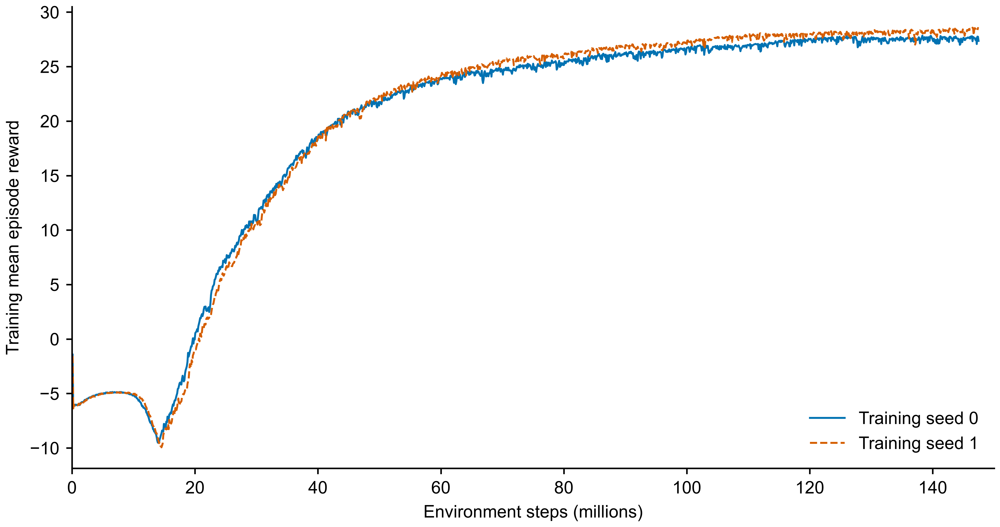

# G1：零指令采样比例对照（未采用）

唯一变量：官方指令重采样时的零指令概率从2%改为20%，其余奖励、PPO、随机化与预算保持一致。2026-10-19完成，任务 `714f05ab-e90b-4aea-b8a8-63bef9569ba5`；两个训练seed各4096环境×24步×1500轮，使用最终model_1499。实际配置核对均通过。

**结论：停车平均误差有所降低，但未解决连续稳定停车，右转退步在两个训练seed和两个评估seed复现。保留原2%基线，不继续训练这组配置。**

表格每格为eval seed=20000 / 21000的成功数，分母各32，门槛29/32。

|条件|原2% seed=0|新20% seed=0|原2% seed=1|新20% seed=1|
|---|---:|---:|---:|---:|
|站立|32 / 32|32 / 32|32 / 32|32 / 32|
|低速前进|32 / 32|32 / 32|32 / 32|32 / 32|
|中速前进|32 / 32|32 / 32|32 / 32|32 / 32|
|左转|32 / 32|10 / 10|32 / 32|32 / 31|
|右转|32 / 32|0 / 0|32 / 32|0 / 0|
|启停|0 / 0|2 / 2|0 / 0|5 / 4|

20%组seed=0无提前终止；seed=1右转分别4、9回合提前终止，其余条件没有。提前终止均计失败，没有拼接reset后的回合。新配置14/24组达标，原配置20/24组；仅两个训练seed提供初步重复性证据。

停车3秒内完成连续1秒稳定窗口的通过数见上表；整个10秒停车段曾达到稳定窗口的数量，新seed=0为10/15，新seed=1为19/20，原两seed均为0/0。停车15–22秒平移速度由约0.053–0.057降至0.032–0.034 m/s，转速由约0.101–0.107降至0.066–0.070 rad/s，但未达到预定连续稳定要求。

新seed=0左/右转角速度误差分别约0.202–0.205 / 0.248–0.252 rad/s；新seed=1分别约0.177–0.180 / 0.297–0.317 rad/s。seed=1右转组均值包含提前终止前的部分窗口，不能视作完整存活回合的性能。站立和两档前进成功数未下降。

保留[实验设定](plan.json)、两seed的[汇总0](run_001/summary.json)/[汇总1](run_002/summary.json)、实际配置核对、训练检查和evaluation目录中的逐回合summary.json。按用户要求，正式与短训练的模型、轨迹、训练日志及TensorBoard大文件已从本地和NAS删除，小体积源码和配置仍保留；不能再对这组模型回放或重新评估。原始官方基线及其全部模型不受影响。

[曲线数据](learning_curve.csv)包含两个seed各1500个日志点，未额外平滑或聚合。曲线是训练回报，不代表行为验收；输入指令分布不同，不直接据此比较策略优劣。原配置完整结果见[官方基线](../phase3_g1_baseline/README.md)。
